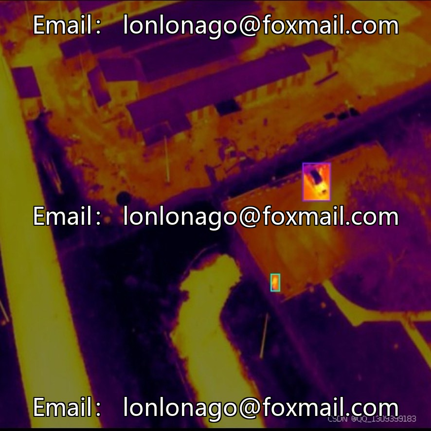
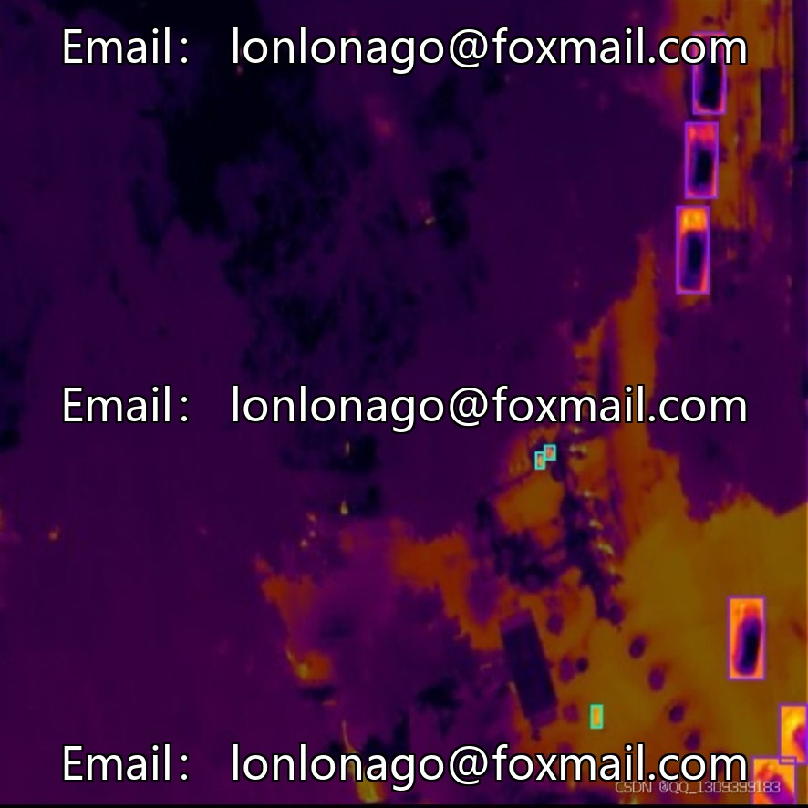
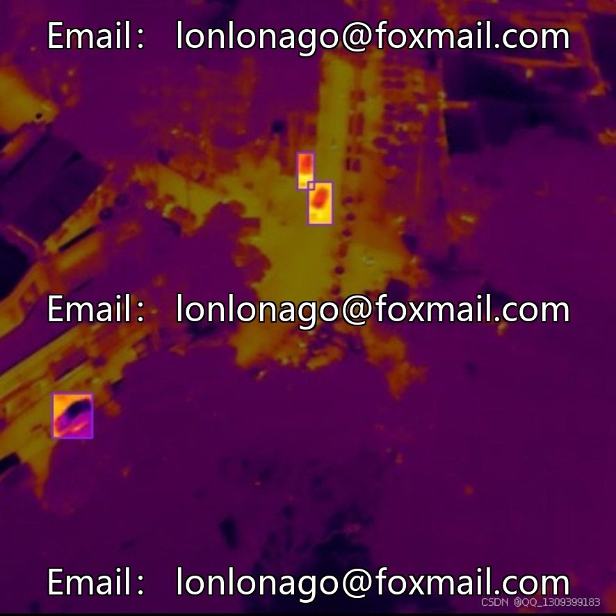
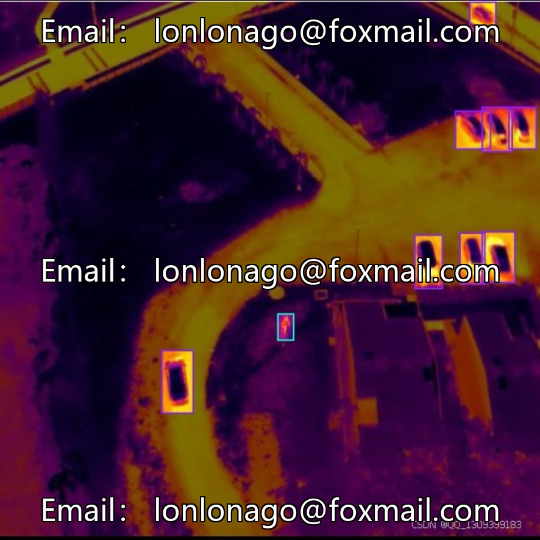
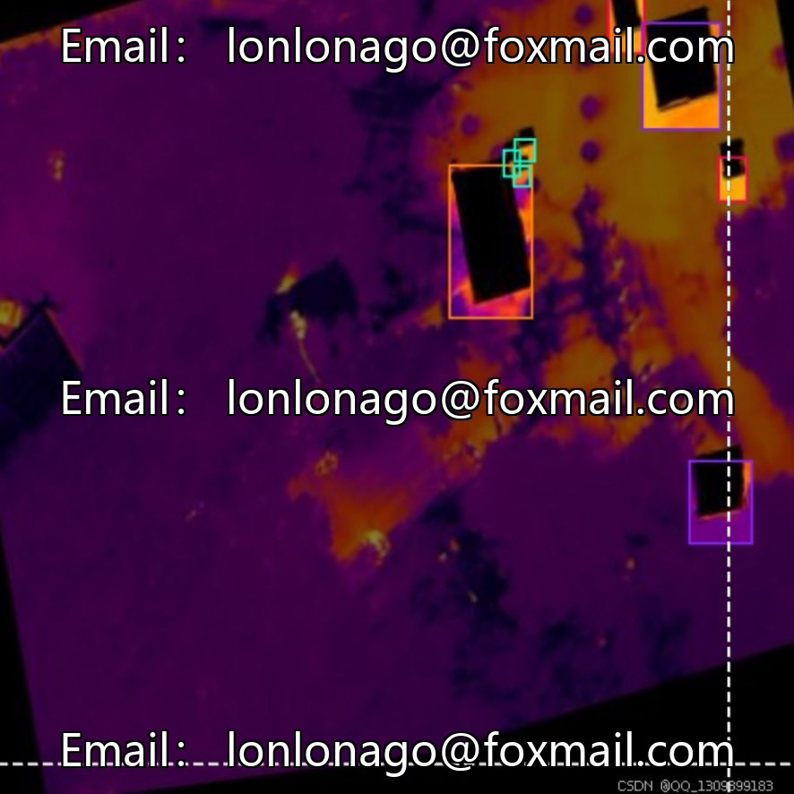
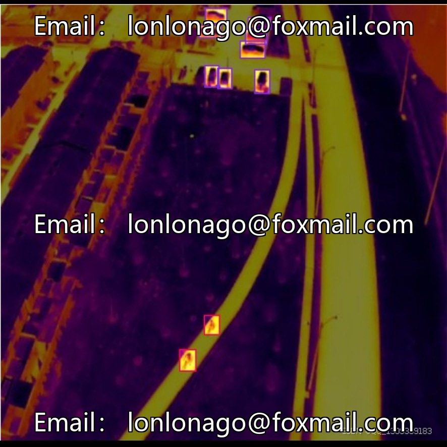

# UAV Infrared Aerial Photography Target Detection Dataset | Issue 10034

## Body

UAV Infrared Aerial Photography Target Detection Dataset | Issue 10034
Designed specifically for low-altitude inspection by infrared drones, suitable for algorithm training in complex environments such as nighttime, rain, snow, and haze.

Basic Data Overview
- Total sample count: 2371 field infrared aerial images, fully retaining the grayscale features of thermal imaging, suitable for robust training in low light and harsh scene conditions.
- Four major annotation categories: Car, Motorbike, Person, Truck, covering common human and vehicle targets on aerial roads.
- Multi-format annotations: YOLO TXT, COCO JSON, Pascal VOC XML, compatible with mainstream detection frameworks.

Data set partitioning (fixed ratio 87:8:4
- Training set 2071 images (87%): Mostly scene samples for feature learning
- Validation set 196 images (8%): Tune parameters in-between training to prevent overfitting
- Test set 104 images (4%): Objective evaluation of model generalization performance on independent samples

Image resolution: The official did not provide the exact number, but based on infrared aerial photography equipment, it is estimated to be between 512×512 ~ 2048×2048; Unified preprocessing of dataset size, reducing the computational overhead caused by varying sizes during training, enabling clear recognition of distant small human and vehicle thermal targets.

Multi-domain landing scenarios
- Security Monitoring: Night border patrols, park inspections to identify suspicious individuals and vehicles.
- Intelligent Transportation: Aerial traffic flow statistics, road surface fault/accident warnings
- Power Inspection: Infrared detection of line and equipment overheating faults
- Forest Fire Prevention and Environmental Protection: Capture surface high temperature fires, abnormally hot areas
- Disaster Emergency Rescue: Identifying Trapped Personnel and Vehicles in Smoke and Ruins After a Disaster
- Military reconnaissance: Remote identification of concealed maneuvering targets

Virtual materials, once sold, are non-refundable.
Interested friends, click "I want" to proceed.

## Images

## Payment

Here is a pay link on Stripe ( https://buy.stripe.com/3cs8yP7sY87d0vu9AB ). Please contact me lonlonago@foxmail.com after funding $89, and I will send you a complete data files , thank you!

